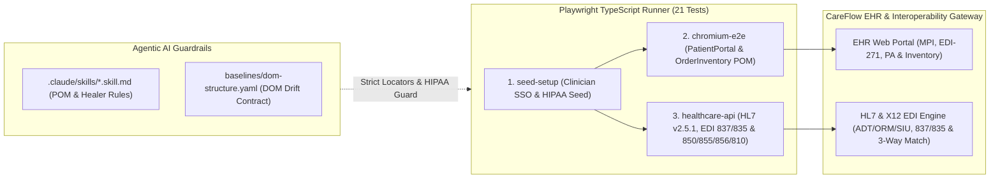

# Healthcare Playwright & Agentic AI QA Framework

[](https://github.com/nguyenluongbao1123/playwright-demo/actions/workflows/playwright-ci.yml)


Enterprise-grade **Healthcare Quality Engineering** framework combining **Playwright TypeScript (Strict Page Object Model)** with **Agentic AI Guardrails** (`.claude/skills/`, deterministic seed state, YAML DOM drift baselines, and Human-in-the-Loop governance).

Designed around both core hospital interoperability pillars:
1. **Clinical & Payer Revenue Cycle (`HL7` + `EDI`)**: Patient MPI & `EDI-271` Eligibility → Outpatient Scheduling (`HL7 ADT^A04` & `SIU^S12`) → Prior Authorization (`EDI 278` PA Gate) & Clinical Supply Ordering (`HL7 ORM^O01`) → ASC X12 `837P` (`NM109` Truncation Guard + Charge Balancing) / `835` Claim Adjudication.
2. **Medical Supply Chain Procure-to-Pay (`EDI 850 / 855 / 856 / 810`)**: Low-Stock Reorder → `850` Purchase Order → `855` PO Acknowledgment (`BAK*AC` / `AT` Backorder) → `856` Advance Ship Notice (`HL S>O>P>I`, GS1 `SSCC-18`, FDA Lot Expiry `DTM*036`) → `810` Invoice **3-Way Match** (`PO1` Price & `SN1` Received Qty Reconciliation).

---

## System Architecture



---

## Repository Structure

```text
healthcare-playwright-agentic-qa/
├── .claude/skills/
│   ├── pom-governance.skill.md          # Strict POM rules, HIPAA hygiene & // Created By AI policy
│   └── playwright-cli.skill.md          # Low-token CLI execution, seed & trace triage playbook
├── .github/workflows/
│   └── playwright-ci.yml                # GitHub Actions CI gate (Typecheck + API + E2E + Artifacts)
├── baselines/
│   └── dom-structure.yaml               # Canonical DOM & ARIA testId baseline for drift detection
├── fixtures/
│   ├── seed.spec.ts                     # Bootstraps clinician storageState & HIPAA-safe seed JSON
│   └── healthcare.fixture.ts            # Typed dependency-injected Page Object & seedData fixtures
├── mocks/
│   └── healthcare-server.ts             # Self-contained CareFlow EHR Portal & HL7/EDI Gateway
├── pages/
│   ├── BasePage.ts                      # Shared navigation, session banner & baseline assertions
│   ├── PatientPortalPage.ts             # MPI lookup, EDI-271 check & HL7 ADT^A04 encounter booking
│   └── OrderInventoryPage.ts            # Supply order creation (ORM^O01) & stock reconciliation
├── postman/
│   ├── collections/                     # Git-native Postman v3 YAML API contract suite (18 requests / 36 assertions)
│   └── environments/                    # Local Sandbox environment configuration (zero hardcoded secrets)
├── utils/
│   ├── hl7-edi-builder.ts               # Deterministic HL7 v2.5.1 & ASC X12 837P payload builders
│   └── baseline-validator.ts            # Cross-checks live DOM hooks against dom-structure.yaml
├── tests/
│   ├── e2e/
│   │   ├── patient-appointment.spec.ts  # Patient intake -> EDI eligibility -> Encounter scheduling
│   │   └── order-inventory-sync.spec.ts # Order fulfillment -> Stock deduction -> EDI 850 low-stock alert
│   └── api/
│       ├── hl7-edi-validation.spec.ts                # HL7 ADT/ORM/SIU, HIPAA PID-19 & EDI 837P/835 claims
│       └── edi-supply-chain-850-855-856-810.spec.ts  # Supply Chain P2P: 850 PO -> 855 -> 856 ASN -> 810 3-Way Match
├── Jenkinsfile                          # Enterprise Jenkins Declarative Pipeline (JUnit + HTML Report)
├── playwright.config.ts                 # Multi-project setup, retries, trace-on-retry & auto webServer
├── tsconfig.json                        # Strict TypeScript configuration with @pages/@fixtures/@utils aliases
└── .env.example                         # Environment variable reference for local & external UAT
```

---

## Clinical & Interoperability Coverage Matrix

| Project | Spec File | Healthcare Domain Focus | Key Quality Gates & Assertions | Tags |
| :--- | :--- | :--- | :--- | :--- |
| `seed-setup` | `fixtures/seed.spec.ts` | Clinician SSO & HIPAA Synthetic Seed | Generates `clinician-state.json` & resets deterministic MPI/Inventory state | Setup |
| `chromium-e2e` | `patient-appointment.spec.ts` | MPI Lookup, `EDI-271`, `HL7 ADT^A04` & `SIU^S12` | Runtime YAML DOM baseline check, payer eligibility, scheduling `SIU^S12` + `ADT^A04` ACK, unknown MRN block | `@smoke` |
| `chromium-e2e` | `order-inventory-sync.spec.ts` | Prior Auth (`PA`), Order (`ORM^O01`) & Inventory | Unverified `PA` block (`422`), atomic stock deduction (`120 → 115`), `LOW_STOCK_REORDER` (`EDI 850`), over-allocation `409` | `@smoke`, `@edi` |
| `healthcare-api` | `hl7-edi-validation.spec.ts` | `HL7 v2.5.1` (`ADT^A01`, `ORM^O01`, `SIU^S12`) | `MSA\|AA` acceptance (`ORC`/`OBR`/`SCH`), missing `PID` (`MSA\|AR`), HIPAA unmasked `PID-19` SSN block (`MSA\|AE`) | `@hl7`, `@smoke` |
| `healthcare-api` | `hl7-edi-validation.spec.ts` | `ASC X12 EDI 837P` → `999` & `835` | `NM109` subscriber truncation guard (`EDI_SEGMENT_TRUNCATION`), `CLM02 = ∑SV1` balancing, `835 CLP` 80/20 math | `@edi`, `@smoke` |
| `healthcare-api` | `edi-supply-chain-850-855-856-810.spec.ts` | `ASC X12 EDI 850 / 855 / 856 / 810` | `850→855` (`BAK*AC` & `ACK*IB` backorder), `856` (`HL S>O>P>I`, GS1 `SSCC-18`, FDA lot expiry `DTM*036`), `810` **3-Way Match** (price & partial-ship qty variance) | `@edi`, `@smoke` |

---

## Agentic AI Governance (The 80/20 Split)

1. **Deterministic Seed Baseline (`fixtures/seed.spec.ts`)**: Eliminates brittle test-to-test coupling by provisioning authenticated clinician storage state and HIPAA Safe-Harbor synthetic records before any UI or API test executes.
2. **Runtime DOM Drift Guardrail (`baselines/dom-structure.yaml`)**: Every E2E suite validates structural `data-testid` contracts prior to interaction, catching silent UI selector regressions without dumping full-page HTML into AI context windows.
3. **Human-in-the-Loop & Guarded Healer Protocol**: AI-assisted specs follow `.claude/skills/pom-governance.skill.md` (zero raw selectors in `tests/`, zero `waitForTimeout`, strict TypeScript), carry explicit review stamps (`// Created By AI - Pending Senior QA Architectural Review`), and restrict self-healing to `[HEALER ALERT]` advisory comments without touching application source code.

---

## Quick Start (Windows / macOS / Linux)

```bash
# 1. Install dependencies & Chromium browser
npm install
npx playwright install chromium

# 2. Verify strict TypeScript & Page Object contracts
npm run typecheck

# 3. Run full test matrix (auto-starts embedded CareFlow EHR & HL7/EDI Gateway)
npm test
```

### Targeted Execution Commands

```bash
npm run test:smoke               # Critical E2E + HL7/EDI smoke gates (@smoke)
npm run test:api                 # Headless HL7 v2.5.1 & X12 EDI contract suites
npm run test:hl7                 # HL7 v2 segment & HIPAA PHI guardrail tests (@hl7)
npm run test:edi                 # All X12 EDI suites: 278 PA + 837P/835 + 850/855/856/810 (@edi)
npm run test:edi:supply-chain    # Supply Chain Procure-to-Pay 850 -> 855 -> 856 -> 810 3-Way Match
npm run test:e2e                 # Chromium E2E Page Object workflows
npm run test:headed              # Watch E2E clinical flows in visible browser
npm run report                   # Open interactive Playwright HTML report
npm run postman:lint             # Validate Git-native Postman v3 collection & environment schema
npm run postman:test             # Run all 18 Postman API requests (requires mock:server running)
```

### Pointing Against External Hospital Staging / UAT

Copy `.env.example` to `.env` and set `USE_EXTERNAL_ENV=true` to bypass the embedded mock server and target a live staging environment:

```env
USE_EXTERNAL_ENV=true
BASE_URL=https://staging-ehr.hospital-system.org
API_BASE_URL=https://staging-api.hospital-system.org/v1/
FACILITY_CODE=DN-HOSP-01
```

---

## Author

**Bao Nguyen Luong** — Senior Healthcare QA Engineer (EDI / HL7 / Clinical E2E / API Automation)
